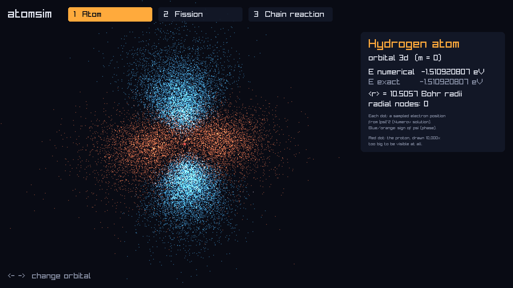
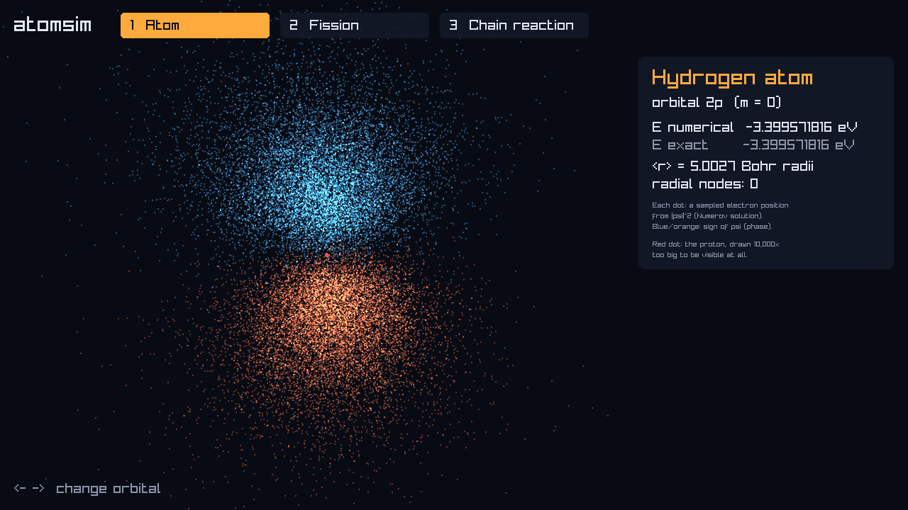
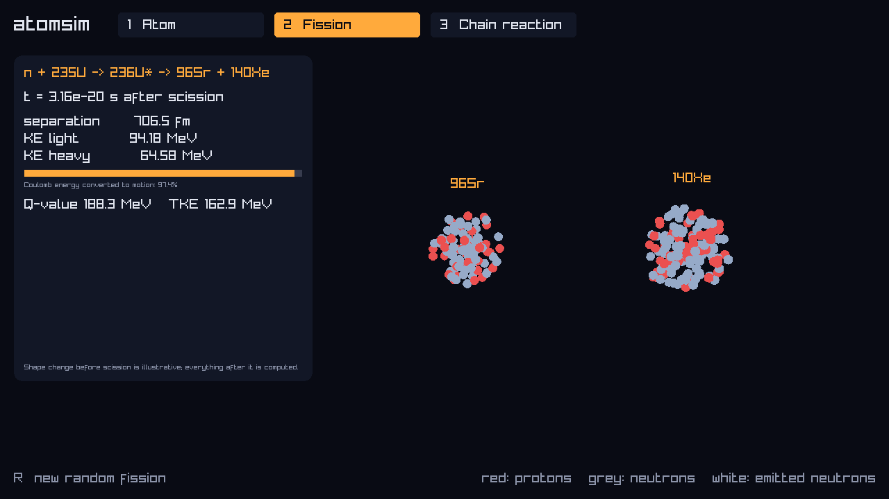
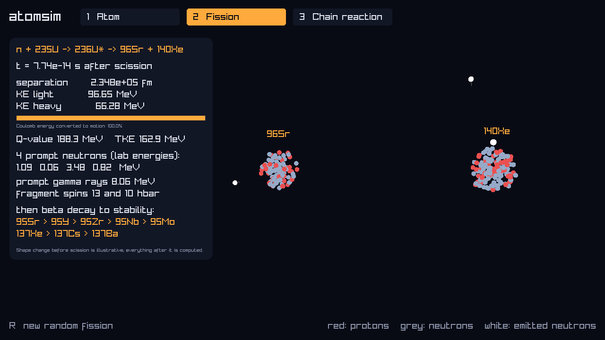
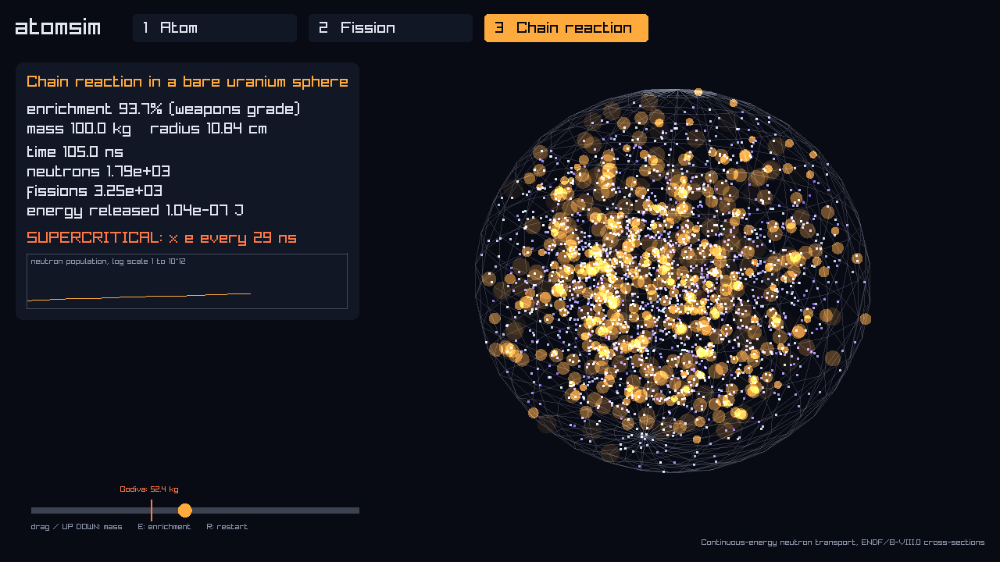

# atomsim

A simulation of an atom, the splitting of a uranium nucleus, and a nuclear chain reaction,
written in C++ and built on real measured physics data.

## Download

Get the zip for your computer from the **[latest release](https://github.com/Fs1lyric/atomsim/releases/latest)**:

| System | File |
|---|---|
| Windows | `atomsim-windows-x64.zip` |
| macOS (Apple Silicon) | `atomsim-macos-arm64.zip` |
| Linux | `atomsim-linux-x64.zip` |

Unzip it and run **atomsim-viz**. Keep the `data` folder next to it.

- **Windows:** if SmartScreen warns you, click *More info → Run anyway*.
- **macOS:** the app isn't signed, so the first time, right-click it and choose *Open*.

## Screenshots

**The atom:** hydrogen's electron cloud, drawn from a solution of the Schrödinger equation.




**Fission:** a neutron splits uranium-235, and the two pieces fly apart.




**Chain reaction:** neutrons multiply through a ball of uranium. Below the critical mass it
dies out; above it, it runs away.



The results match real experiments to within a few percent, and the tests check that.

## Build it yourself

```sh
cmake -S . -B build -DATOMSIM_VIZ=ON && cmake --build build -j
./build/atomsim-viz
```

Press 1, 2 or 3 to switch scenes.
